# AeroTrip — Future Plan: Flight Search & Booking

> **Status:** Proposal
> **Goal:** Turn the current visual-only landing page into a working end-to-end
> flight search and booking system with a real frontend and backend.
> **Constraint:** Standard CRUD only. No cache layer, no queue, no microservices,
> no unnecessary abstractions.

---

## 1. Where the project is today

AeroTrip is currently a **static visual scaffold** built with Preact, TypeScript,
Vite, and Tailwind CSS v4. Nothing is interactive beyond hover states and anchor
links.

### Current structure

```
src/
├── app.tsx                      # Composes landing sections
├── main.tsx                     # Preact render entry
├── components/
│   ├── DestinationCard.tsx
│   ├── FlightDealCard.tsx
│   ├── Navbar.tsx
│   └── ui/
│       ├── Badge.tsx
│       ├── Button.tsx
│       ├── Container.tsx
│       ├── FieldVisual.tsx      # Static, not an <input>
│       └── SectionHeading.tsx
├── data/                        # Hard-coded mock content
├── layouts/MainLayout.tsx
├── sections/                    # Landing page sections
├── styles/index.css             # Tailwind + navy/sky design tokens
└── types/index.ts               # Domain-shaped TypeScript interfaces
```

### Current design characteristics

| Aspect | Current state |
| --- | --- |
| Rendering | Preact function components, no router |
| Styling | Tailwind v4 tokens: `navy-*`, `sky-*`, custom shadows |
| Layout | `MainLayout` = `Navbar` + `main` + `Footer` |
| Data | Static arrays in `src/data`, typed in `src/types` |
| Search | `FlightSearchCard` is visual-only (`FieldVisual`, no inputs) |
| Buttons | `Button` intentionally has **no click handlers** |
| Backend | None |
| Persistence | None |

The comment in `src/types/index.ts` already states the intent:

> These are intentionally shaped like the entities a future API / database
> layer would return, so presentational components can be swapped from mock data
> to real data without a redesign.

This plan follows that intent rather than replacing it.

---

## 2. Next feature

### 2.1 Feature statement

**Flight Search & Booking** — a traveller can search real (seeded) flight
inventory, choose an itinerary, enter passenger details, create a booking, and
later look up or cancel that booking.

The landing page stays as the entry point. The search card becomes a real form.

### 2.2 MVP scope

- One-way and round-trip search.
- Search by origin, destination, departure date, optional return date,
  passenger count, and cabin class.
- Flight results with filters for stops, airline, and price.
- Flight detail view.
- Passenger and contact details form.
- Booking creation with atomic seat decrement.
- Booking confirmation with a human-readable reference.
- Guest booking lookup by reference + email.
- Update booking contact details.
- Cancel booking (soft cancel, seats restored).
- Admin flight inventory CRUD protected by a simple API key.
- Seed data for airports, airlines, and flights.

### 2.3 Out of scope (deliberately)

- Redis, in-memory cache, CDN logic, or any caching layer.
- Real payment gateway (payment step is mocked/omitted).
- User accounts, OAuth, sessions, or JWT auth.
- Email/SMS delivery (confirmation is shown in-app and logged).
- Multi-city itineraries.
- Seat maps and seat selection.
- Real-time airline/GDS integrations.
- Background jobs, message queues, or webhooks.
- Microservices.

### 2.4 User stories

| ID | Story | Acceptance criteria |
| --- | --- | --- |
| US-01 | As a traveller, I can search flights for a route and date. | Valid search returns matching flights; invalid input shows field errors. |
| US-02 | As a traveller, I can filter and sort results. | Filters update results without a full page reload; empty state is shown when nothing matches. |
| US-03 | As a traveller, I can view flight details. | Details show airline, route, times, duration, stops, cabin, and price. |
| US-04 | As a traveller, I can enter passenger and contact details. | Required fields validate; passenger count matches search. |
| US-05 | As a traveller, I can create a booking. | Booking persists, reference is generated, seats decrement atomically. |
| US-06 | As a traveller, I can see my confirmation. | Confirmation shows reference, itinerary, passengers, and total. |
| US-07 | As a traveller, I can look up a booking. | Correct reference + email returns the booking; mismatch returns 404. |
| US-08 | As a traveller, I can update contact details. | Allowed fields update and persist. |
| US-09 | As a traveller, I can cancel a booking. | Status becomes `cancelled`; seats are restored. |
| US-10 | As an admin, I can manage flight inventory. | Create, read, update, and delete flights via protected endpoints. |

---

## 3. Design

### 3.1 Guiding principles

1. **Reuse the existing visual language.** Keep `Container`, `SectionHeading`,
   `Button`, `Badge`, the navy/sky palette, and the same card/rounded/shadow
   treatment on every new page.
2. **Extend the existing types.** The current domain types are already close to
   API DTOs. Add fields instead of creating a parallel type system.
3. **One frontend app, one backend service, one database.** No distributed
   systems.
4. **Thin layers.** Route handler → validation → service → SQL. No repository
   interface hierarchy, no dependency injection container.
5. **CRUD over orchestration.** Search is a filtered read. Booking is a
   transactional create/read/update/delete.
6. **No cache.** SQLite reads are fast enough for this scale. Add indexes, not a
   cache.

### 3.2 Target architecture

**PlantUML**

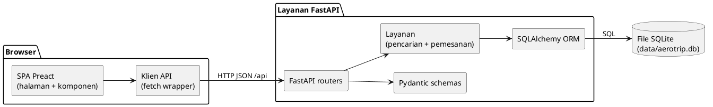

**Mermaid**

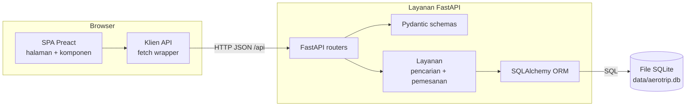

### 3.3 How the current design maps to the new system

| Current artifact | Future use |
| --- | --- |
| `src/app.tsx` | Becomes the router shell; existing sections move unchanged into `pages/HomePage.tsx`. |
| `src/layouts/MainLayout.tsx` | Keeps `Navbar` + `Footer` for every route. |
| `src/sections/HeroSection.tsx` | Home page hero; keeps its visual treatment. |
| `src/sections/FlightSearchCard.tsx` | Becomes a real controlled `<form>`; submits to `/search` via URL query params. |
| `src/components/ui/FieldVisual.tsx` | Kept for display; new `TextField`, `SelectField`, `DateField`, `Stepper` reuse its exact classes. |
| `src/components/ui/Button.tsx` | Extended with `type`, `disabled`, `onClick`, and `loading` (currently no handlers by design). |
| `src/components/FlightDealCard.tsx` | Kept for the curated landing "deals" section; new `FlightResultCard` uses the same visual grammar. |
| `src/types/index.ts` | Extended with `Flight`, `SearchParams`, `Booking`, `Passenger`, and API response types. |
| `src/data/flightDeals.ts` | Stays as curated landing content; live inventory comes from the API. |
| `src/styles/index.css` | Unchanged tokens; new pages use the same palette and shadows. |
| `src/data/destinations.ts` | Remains static marketing content for the landing page. |
| `Navbar` links | Updated to route-aware links (`/`, `/search`, `/manage`). |

### 3.4 Frontend design

#### Routing

Add `preact-iso` (official, tiny) and wrap the app:

```tsx
import { LocationProvider, Router, Route } from "preact-iso";

export function App() {
  return (
    <LocationProvider>
      <MainLayout>
        <Router>
          <Route path="/" component={HomePage} />
          <Route path="/search" component={SearchResultsPage} />
          <Route path="/flights/:id" component={FlightDetailPage} />
          <Route path="/booking" component={BookingPage} />
          <Route path="/bookings/:reference" component={ConfirmationPage} />
          <Route path="/manage" component={ManageBookingPage} />
          <Route default component={NotFoundPage} />
        </Router>
      </MainLayout>
    </LocationProvider>
  );
}
```

#### Pages

| Route | Purpose |
| --- | --- |
| `/` | Existing landing page, now with a working search form. |
| `/search` | Results for outbound and optional return flights. |
| `/flights/:id` | Single flight detail. |
| `/booking` | Passenger + contact form for selected flight IDs. |
| `/bookings/:reference` | Confirmation / booking detail. |
| `/manage` | Booking lookup by reference + email; cancel/update actions. |

#### State

- Search criteria live in **URL query params** — shareable, back-button safe.
- Booking draft lives in **local component state**.
- No global store, no query library, no cache.
- The confirmation and manage pages fetch the booking by reference.

#### UI primitives to add

- `TextField` — label, value, error, hint, input.
- `SelectField` — origin/destination/cabin.
- `DateField` — native date input styled like `FieldVisual`.
- `Stepper` — passenger count.
- `Alert` — inline error/success.
- `Spinner` — loading state.

All reuse the existing visual classes:

```
rounded-2xl border border-navy-100 bg-white px-4 py-3
text-[10px] font-bold uppercase tracking-[0.14em] text-navy-400
text-sm font-semibold text-navy-900
```

#### API client

One small module, `src/lib/api.ts`:

```ts
const BASE = import.meta.env.VITE_API_URL ?? "";

async function request<T>(path: string, init?: RequestInit): Promise<T> {
  const res = await fetch(`${BASE}${path}`, {
    headers: { "Content-Type": "application/json", ...init?.headers },
    ...init,
  });

  if (!res.ok) {
    const body = await res.json().catch(() => null);
    throw new ApiError(res.status, body?.error?.message ?? res.statusText);
  }

  return res.status === 204 ? (undefined as T) : res.json();
}
```

During development, Vite proxies `/api` to `http://localhost:3001` so no CORS
configuration is needed locally.

### 3.5 Backend design

#### Stack

| Concern | Choice | Reason |
| --- | --- | --- |
| Language / runtime | **Python 3.12+** | Standard, typed, well supported. |
| HTTP framework | **FastAPI** | Built-in validation, async handlers, OpenAPI docs. |
| Validation | **Pydantic v2** | Typed request/response models and settings. |
| ORM | **SQLAlchemy 2.0** | Standard Python ORM with clean transactions. |
| Database | **SQLite** | Zero external service, file-based. |
| Server | **Uvicorn** | Standard ASGI server for FastAPI. |
| IDs | `uuid.uuid4()` | Built in. |
| Money | Integer cents | Avoid float errors. |

SQLAlchemy handles models and transactions. No cache and no extra data layer.

#### Request flow

```
HTTP request
  → FastAPI router
  → Pydantic validation (422 on failure)
  → service function
  → SQLAlchemy session / transaction
  → Pydantic response model → JSON
  → error envelope
```

FastAPI automatically exposes interactive docs at `/docs` and the OpenAPI
schema at `/openapi.json`.

#### Error envelope

```json
{
  "error": {
    "code": "VALIDATION_ERROR",
    "message": "Passenger count must be between 1 and 9.",
    "details": []
  }
}
```

Status codes: `200`, `201`, `204`, `400`, `404`, `409`, `422`, `500`.

### 3.6 Data model

SQLite, WAL mode enabled, foreign keys enabled.

```sql
CREATE TABLE airports (
  id          TEXT PRIMARY KEY,
  code        TEXT NOT NULL UNIQUE,      -- IATA, e.g. CGK
  city        TEXT NOT NULL,
  country     TEXT NOT NULL,
  name        TEXT NOT NULL
);

CREATE TABLE airlines (
  id          TEXT PRIMARY KEY,
  code        TEXT NOT NULL UNIQUE,      -- e.g. GA
  name        TEXT NOT NULL
);

CREATE TABLE flights (
  id                TEXT PRIMARY KEY,
  airline_id        TEXT NOT NULL REFERENCES airlines(id),
  flight_number     TEXT NOT NULL,
  origin_code       TEXT NOT NULL REFERENCES airports(code),
  destination_code  TEXT NOT NULL REFERENCES airports(code),
  departure_at      TEXT NOT NULL,       -- ISO 8601 UTC
  arrival_at        TEXT NOT NULL,       -- ISO 8601 UTC
  duration_minutes  INTEGER NOT NULL,
  stops             INTEGER NOT NULL DEFAULT 0,
  cabin_class       TEXT NOT NULL,       -- economy | premium | business | first
  price_cents       INTEGER NOT NULL,
  currency          TEXT NOT NULL DEFAULT 'USD',
  seats_available   INTEGER NOT NULL,
  status            TEXT NOT NULL DEFAULT 'scheduled',
  created_at        TEXT NOT NULL,
  updated_at        TEXT NOT NULL
);

CREATE INDEX idx_flights_route_date
  ON flights(origin_code, destination_code, departure_at);

CREATE TABLE bookings (
  id                 TEXT PRIMARY KEY,
  reference          TEXT NOT NULL UNIQUE,   -- AT-XXXXXX
  outbound_flight_id TEXT NOT NULL REFERENCES flights(id),
  return_flight_id   TEXT REFERENCES flights(id),
  trip_type          TEXT NOT NULL,          -- one-way | round-trip
  cabin_class        TEXT NOT NULL,
  contact_email      TEXT NOT NULL,
  contact_phone      TEXT,
  passenger_count    INTEGER NOT NULL,
  total_cents        INTEGER NOT NULL,
  currency           TEXT NOT NULL DEFAULT 'USD',
  status             TEXT NOT NULL DEFAULT 'confirmed',
  created_at         TEXT NOT NULL,
  updated_at         TEXT NOT NULL
);

CREATE TABLE passengers (
  id              TEXT PRIMARY KEY,
  booking_id      TEXT NOT NULL REFERENCES bookings(id) ON DELETE CASCADE,
  full_name       TEXT NOT NULL,
  date_of_birth   TEXT NOT NULL,
  passport_number TEXT,
  seat_no         TEXT
);
```

**Mermaid ER diagram**

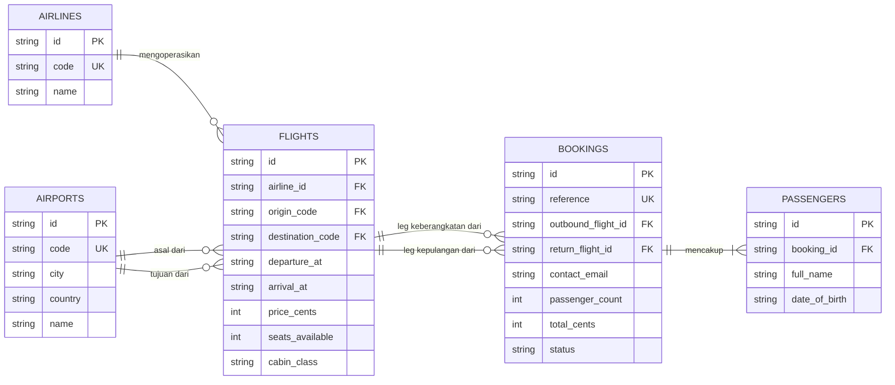

### 3.7 API contract

| Method | Path | Purpose | Auth |
| --- | --- | --- | --- |
| GET | `/api/health` | Health check | none |
| GET | `/api/airports?q=jak` | Airport lookup | none |
| GET | `/api/flights/search` | Search outbound + return | none |
| GET | `/api/flights/:id` | Flight detail | none |
| POST | `/api/bookings` | Create booking | none (guest) |
| GET | `/api/bookings/:reference?email=` | Read booking | reference + email |
| GET | `/api/bookings?email=` | List bookings by email | email |
| PATCH | `/api/bookings/:id` | Update contact details | reference + email |
| DELETE | `/api/bookings/:id` | Cancel booking (soft) | reference + email |
| POST | `/api/admin/flights` | Create flight | `x-admin-key` |
| PUT | `/api/admin/flights/:id` | Update flight | `x-admin-key` |
| DELETE | `/api/admin/flights/:id` | Delete flight | `x-admin-key` |

#### Search request

```
GET /api/flights/search
  ?origin=CGK
  &destination=DPS
  &departDate=2026-03-14
  &returnDate=2026-03-23
  &passengers=1
  &cabin=economy
  &maxStops=0
  &sort=price
```

#### Search response

```json
{
  "outbound": [
    {
      "id": "flt_...",
      "airline": { "code": "GA", "name": "Garuda Indonesia" },
      "flightNumber": "GA 402",
      "from": { "code": "CGK", "city": "Jakarta", "country": "Indonesia" },
      "to": { "code": "DPS", "city": "Denpasar", "country": "Indonesia" },
      "departureAt": "2026-03-14T01:15:00.000Z",
      "arrivalAt": "2026-03-14T03:10:00.000Z",
      "durationMinutes": 115,
      "stops": 0,
      "cabinClass": "economy",
      "price": 189,
      "currency": "USD",
      "seatsAvailable": 42
    }
  ],
  "return": []
}
```

`return` is `null` for one-way searches.

#### Create booking request

```json
{
  "tripType": "round-trip",
  "outboundFlightId": "flt_...",
  "returnFlightId": "flt_...",
  "cabinClass": "economy",
  "contactEmail": "you@example.com",
  "contactPhone": "+62 812 0000 0000",
  "passengers": [
    {
      "fullName": "Ayu Lestari",
      "dateOfBirth": "1995-05-14",
      "passportNumber": "A1234567"
    }
  ]
}
```

#### Create booking response `201`

```json
{
  "id": "bkg_...",
  "reference": "AT-7K2M9Q",
  "status": "confirmed",
  "tripType": "round-trip",
  "outboundFlight": { "...": "Flight" },
  "returnFlight": { "...": "Flight" },
  "passengers": [{ "...": "Passenger" }],
  "contactEmail": "you@example.com",
  "total": 378,
  "currency": "USD",
  "createdAt": "2026-03-01T10:00:00.000Z"
}
```

### 3.8 Booking transaction

Booking creation must be atomic. No distributed lock, no queue — one SQLAlchemy
session transaction:

```python
with session.begin():
    flight_ids = [payload.outbound_flight_id, payload.return_flight_id]
    for flight_id in filter(None, flight_ids):
        result = session.execute(
            update(Flight)
            .where(
                Flight.id == flight_id,
                Flight.seats_available >= payload.passenger_count,
            )
            .values(
                seats_available=Flight.seats_available - payload.passenger_count
            )
        )
        if result.rowcount != 1:
            raise HTTPException(status_code=409, detail="Not enough seats")

    booking = Booking(
        reference=generate_reference(),
        outbound_flight_id=payload.outbound_flight_id,
        return_flight_id=payload.return_flight_id,
        passenger_count=len(payload.passengers),
        total_cents=calculate_total(...),
        contact_email=payload.contact_email,
    )
    booking.passengers = [Passenger(**p.model_dump()) for p in payload.passengers]
    session.add(booking)
```

`session.begin()` commits on success and rolls back on any exception. The
`rowcount` check prevents overselling under concurrency. Cancellation runs the
reverse seat increment in a transaction and sets `status = "cancelled"`.

### 3.9 Project structure

```
AeroTrip/
├── index.html
├── package.json                  # web app
├── vite.config.ts                # add /api dev proxy
├── src/                          # existing frontend, extended
│   ├── app.tsx                   # router
│   ├── pages/
│   │   ├── HomePage.tsx
│   │   ├── SearchResultsPage.tsx
│   │   ├── FlightDetailPage.tsx
│   │   ├── BookingPage.tsx
│   │   ├── ConfirmationPage.tsx
│   │   ├── ManageBookingPage.tsx
│   │   └── NotFoundPage.tsx
│   ├── components/
│   │   ├── search/
│   │   │   ├── SearchForm.tsx
│   │   │   ├── FlightResultCard.tsx
│   │   │   └── ResultsFilters.tsx
│   │   ├── booking/
│   │   │   ├── PassengerFields.tsx
│   │   │   ├── ContactFields.tsx
│   │   │   └── PriceSummary.tsx
│   │   └── ui/
│   │       ├── TextField.tsx
│   │       ├── SelectField.tsx
│   │       ├── DateField.tsx
│   │       ├── Stepper.tsx
│   │       ├── Alert.tsx
│   │       └── Spinner.tsx
│   ├── lib/
│   │   ├── api.ts
│   │   ├── format.ts
│   │   └── validation.ts
│   └── types/index.ts            # extended
└── server/
    ├── requirements.txt
    ├── .env.example
    ├── pyproject.toml            # pytest + ruff config
    ├── app/
    │   ├── main.py               # FastAPI app + CORS + error handlers
    │   ├── config.py             # pydantic-settings
    │   ├── database.py           # SQLAlchemy engine + session
    │   ├── models.py             # ORM models
    │   ├── schemas.py            # Pydantic request/response models
    │   ├── deps.py               # get_db, require_admin
    │   ├── routers/
    │   │   ├── airports.py
    │   │   ├── flights.py
    │   │   ├── bookings.py
    │   │   └── admin_flights.py
    │   ├── services/
    │   │   ├── flight_service.py
    │   │   └── booking_service.py
    │   └── lib/
    │       ├── reference.py
    │       └── money.py
    ├── seed.py
    └── tests/
        ├── conftest.py
        ├── test_flights.py
        └── test_bookings.py
```

Root scripts:

```json
{
  "scripts": {
    "dev": "vite",
    "dev:api": "cd server && uvicorn app.main:app --reload --port 3001",
    "build": "tsc --noEmit && vite build",
    "typecheck": "tsc --noEmit",
    "test:api": "cd server && pytest"
  }
}
```

Python setup:

```bash
cd server
python -m venv .venv
source .venv/bin/activate
pip install -r requirements.txt
python seed.py            # create tables + sample inventory
uvicorn app.main:app --reload --port 3001
```

Run the web app and API in two terminals during development.

---

## 4. Delivery plan

| Phase | Work | Deliverable | Est. |
| --- | --- | --- | --- |
| **0. Foundations** | Extend types; add router, API client, UI inputs; create `server/` skeleton; add Vite proxy. | App still builds; `/api/health` returns `200`. | 0.5 day |
| **1. Backend CRUD** | Schema + seed; airports/flights search; booking create/read/update/cancel; admin flight CRUD; validation + errors. | All endpoints covered by `pytest`. | 1.5 days |
| **2. Search UI** | Real search form; results page; filters/sort; loading, empty, and error states; URL sync. | Search CGK → DPS returns seeded flights. | 1 day |
| **3. Booking UI** | Flight detail; passenger/contact form; price summary; submit; confirmation page. | Happy path creates a booking and shows a reference. | 1.5 days |
| **4. Manage booking** | Lookup by reference + email; update contact; cancel; seat restoration. | Booking can be found, updated, and cancelled. | 1 day |
| **5. Hardening** | Edge cases, validation, tests, README, env docs, deployment. | Typecheck, build, and API tests pass; deployed smoke test passes. | 1 day |

**Total estimate:** ~6.5 working days for one developer.

---

## 5. Use cases

### 5.1 Actors

| Actor | Description |
| --- | --- |
| **Traveler** | Guest user searching and booking flights. |
| **Admin** | Manages flight inventory via protected endpoints. |
| **System** | Validates availability, calculates fare, persists data. |

### 5.2 Use case list

| ID | Use case | Actor | Outcome |
| --- | --- | --- | --- |
| UC-01 | Search flights | Traveler | Matching outbound/return flights returned. |
| UC-02 | View flight details | Traveler | Full itinerary shown. |
| UC-03 | Enter passenger & contact details | Traveler | Validated booking draft. |
| UC-04 | Create booking | Traveler | Booking persisted, reference issued, seats decremented. |
| UC-05 | View confirmation | Traveler | Booking details and reference shown. |
| UC-06 | Look up booking | Traveler | Booking found by reference + email. |
| UC-07 | Update booking | Traveler | Contact details updated. |
| UC-08 | Cancel booking | Traveler | Status `cancelled`, seats restored. |
| UC-09 | Manage flight inventory (CRUD) | Admin | Flight records created, read, updated, deleted. |

### 5.3 PlantUML use case diagram

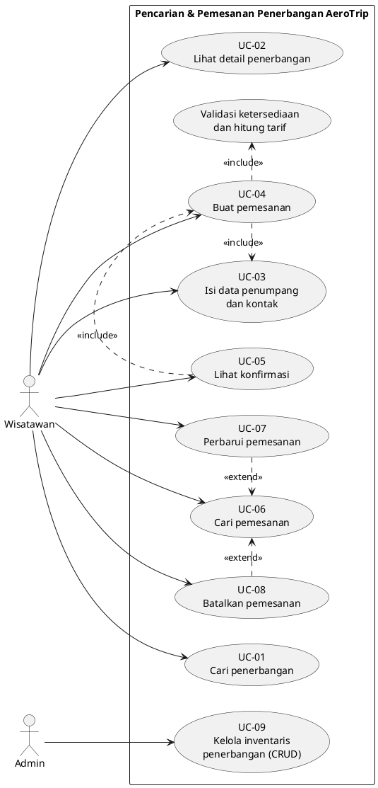

### 5.4 Mermaid use case flowchart

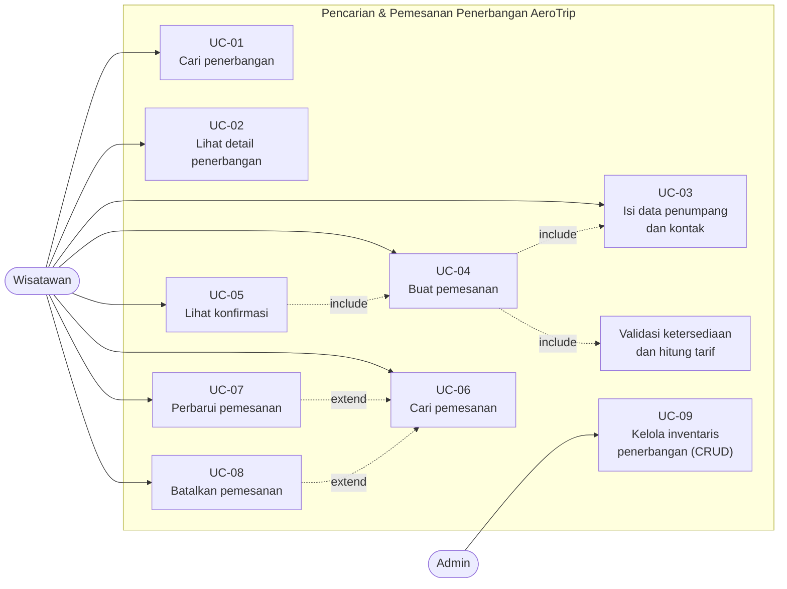

### 5.5 Key use case specifications

#### UC-01 Search flights

- **Actor:** Traveler
- **Precondition:** Airports and flights are seeded.
- **Main flow:**
  1. Traveler enters origin, destination, departure date, optional return date,
     passengers, and cabin class.
  2. Frontend validates required fields and navigates to `/search?...`.
  3. Frontend calls `GET /api/flights/search`.
  4. Backend validates query params and queries `flights` by route, date range,
     cabin, and seats.
  5. Backend returns outbound and (if round-trip) return flight arrays.
  6. Frontend renders results with loading, empty, and error states.
- **Alternative:** No flights → empty state with a "change search" action.
- **Postcondition:** Results are displayed; no data is written.

#### UC-04 Create booking

- **Actor:** Traveler
- **Precondition:** Search completed; valid flight IDs and seat availability.
- **Main flow:**
  1. Traveler selects outbound and optional return flights.
  2. Traveler enters passenger and contact details.
  3. Frontend validates and calls `POST /api/bookings`.
  4. Backend validates payload, loads both flights, and checks seats.
  5. Backend computes total and starts a transaction.
  6. Backend decrements seats, inserts booking and passengers, commits.
  7. Backend returns the booking with a unique reference.
  8. Frontend navigates to `/bookings/:reference`.
- **Alternative:** Seats no longer available → `409`, frontend shows an
  availability error and offers to re-search.
- **Postcondition:** Booking recorded; seats decremented.

#### UC-08 Cancel booking

- **Actor:** Traveler
- **Precondition:** Booking exists with status `confirmed`.
- **Main flow:**
  1. Traveler opens `/manage` and enters reference + email.
  2. Frontend calls `GET /api/bookings/:reference?email=...`.
  3. Traveler selects "Cancel booking".
  4. Frontend calls `DELETE /api/bookings/:id` with matching email.
  5. Backend starts a transaction, sets status to `cancelled`, restores seats,
     and commits.
  6. Frontend shows the updated status.
- **Alternative:** Booking not found or email mismatch → `404`.
- **Postcondition:** Seats restored; booking remains readable but cancelled.

---

## 6. SDLC

The delivery follows a small, iterative software development life cycle: scope,
design, build, integrate, test, deploy, maintain. Each phase has a gate so work
does not move forward on unverified assumptions.

### 6.1 PlantUML SDLC activity diagram

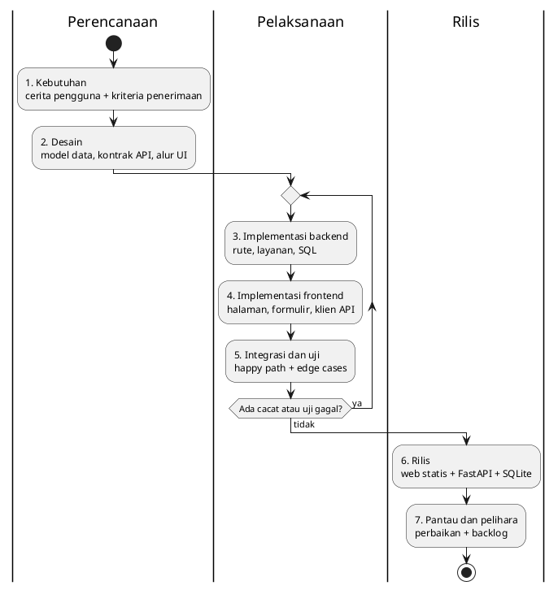

### 6.2 Mermaid SDLC flowchart

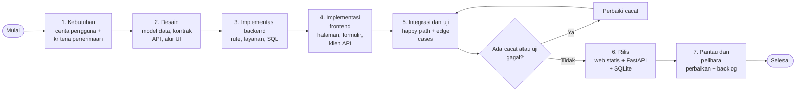

### 6.3 Phase gates

| Gate | Check |
| --- | --- |
| G1 — Scope | User stories and out-of-scope list are agreed. |
| G2 — Design | Schema and API contract are frozen for the MVP. |
| G3 — Backend | All CRUD endpoints pass automated tests. |
| G4 — Frontend | Search → book → confirm works end-to-end. |
| G5 — Quality | `typecheck`, `build`, and API tests pass. |
| G6 — Release | Deployed smoke test succeeds; README is current. |

---

## 7. Activity diagrams

Each use case has a matching activity diagram in both PlantUML and Mermaid.
Error branches loop back to the form where the user can correct the input.

### 7.1 Overview — search to booking

**PlantUML**

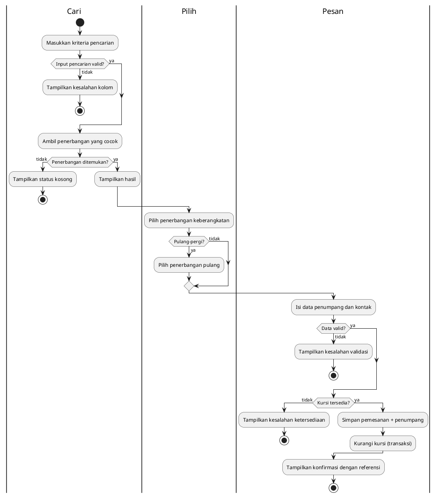

**Mermaid**

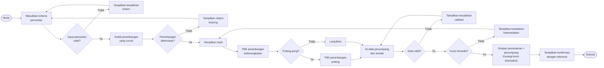

### 7.2 UC-01 — Search flights

**PlantUML**

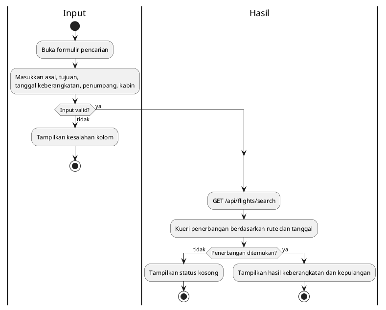

**Mermaid**

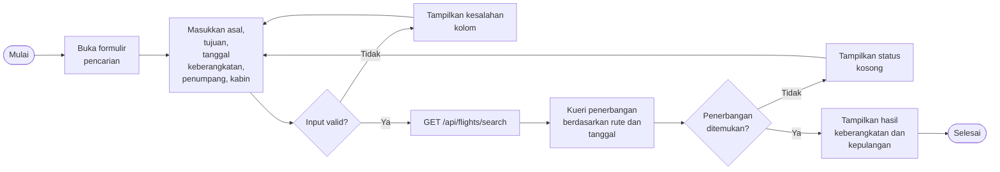

### 7.3 UC-02 — View flight details

**PlantUML**

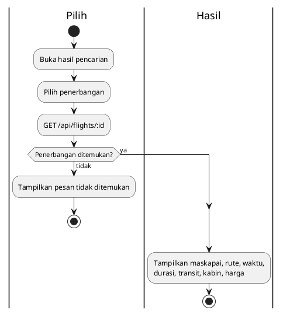

**Mermaid**

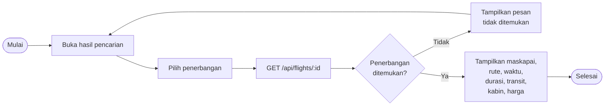

### 7.4 UC-03 — Enter passenger and contact details

**PlantUML**

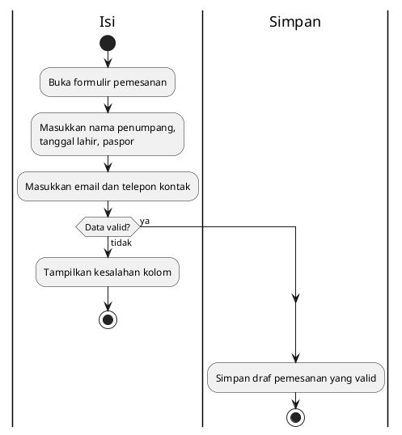

**Mermaid**

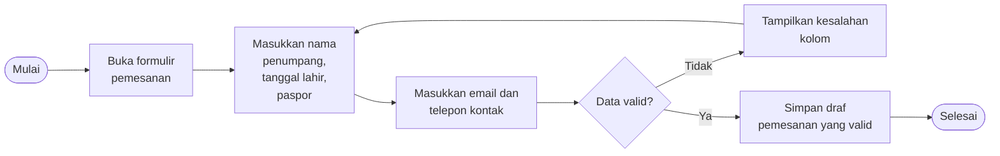

### 7.5 UC-04 — Create booking

**PlantUML**

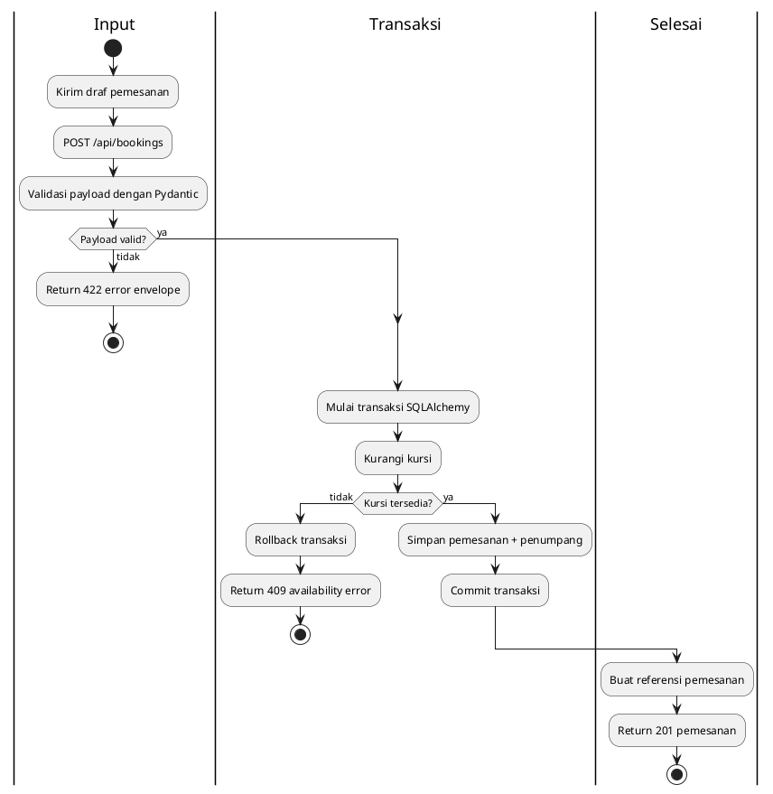

**Mermaid**

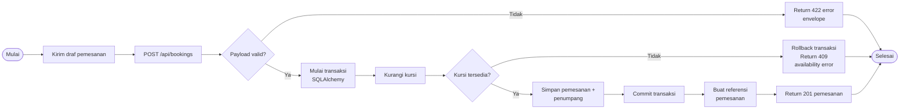

### 7.6 UC-05 — View confirmation

**PlantUML**

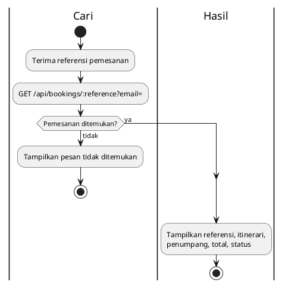

**Mermaid**

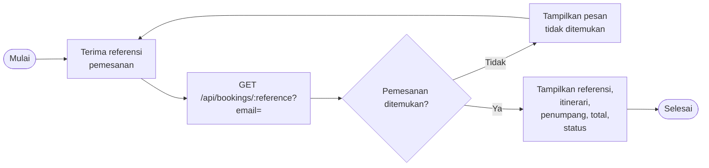

### 7.7 UC-06 — Look up booking

**PlantUML**

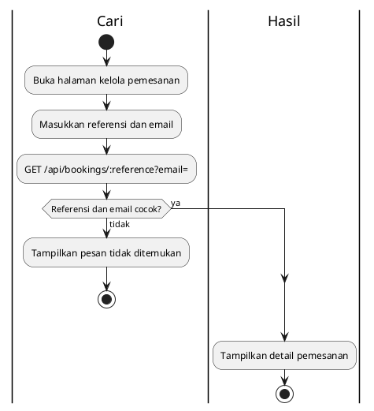

**Mermaid**

```mermaid
%%{init: {"flowchart": {"nodeSpacing": 45, "rankSpacing": 70}, "themeVariables": {"fontSize": "19px"}}}%%
flowchart LR
  A([Mulai]) --> B["Buka halaman kelola<br/>pemesanan"]
  B --> C["Masukkan referensi<br/>dan email"]
  C --> D["GET /api/bookings/:reference?email="]
  D --> E{"Referensi dan email<br/>cocok?"}
  E -->|Tidak| F["Tampilkan pesan<br/>tidak ditemukan"]
  F --> C
  E -->|Ya| G["Tampilkan detail<br/>pemesanan"]
  G --> H([Selesai])
```

### 7.8 UC-07 — Update booking

**PlantUML**

```plantuml
@startuml AeroTrip-Activity-UC07
|Cari|
start
:Cari pemesanan;
:Ubah data kontak;
if (Data valid?) then (tidak)
  :Tampilkan kesalahan kolom;
  stop
else (ya)
endif
|Ubah|
:PATCH /api/bookings/:id;
:Perbarui kolom kontak;
:Return pemesanan yang diperbarui;
stop
@enduml
```

**Mermaid**

```mermaid
%%{init: {"flowchart": {"nodeSpacing": 45, "rankSpacing": 70}, "themeVariables": {"fontSize": "19px"}}}%%
flowchart LR
  A([Mulai]) --> B["Cari pemesanan"]
  B --> C["Ubah data kontak"]
  C --> D{"Data valid?"}
  D -->|Tidak| E["Tampilkan kesalahan<br/>kolom"]
  E --> C
  D -->|Ya| F["PATCH /api/bookings/:id"]
  F --> G["Perbarui kolom<br/>kontak"]
  G --> H["Return pemesanan<br/>yang diperbarui"]
  H --> I([Selesai])
```

### 7.9 UC-08 — Cancel booking

**PlantUML**

```plantuml
@startuml AeroTrip-Activity-UC08
|Cari|
start
:Cari pemesanan;
if (Status terkonfirmasi?) then (tidak)
  :Tampilkan pesan tidak dapat dibatalkan;
  stop
else (ya)
endif
|Batal|
:DELETE /api/bookings/:id;
:Mulai transaksi SQLAlchemy;
:Atur status = cancelled;
:Pulihkan kursi;
:Commit transaksi;
|Selesai|
:Return 204 No Content;
:Tampilkan status dibatalkan;
stop
@enduml
```

**Mermaid**

```mermaid
%%{init: {"flowchart": {"nodeSpacing": 45, "rankSpacing": 70}, "themeVariables": {"fontSize": "19px"}}}%%
flowchart LR
  A([Mulai]) --> B["Cari pemesanan"]
  B --> C{"Status<br/>terkonfirmasi?"}
  C -->|Tidak| D["Tampilkan pesan<br/>tidak dapat<br/>dibatalkan"]
  D --> E([Selesai])
  C -->|Ya| F["DELETE /api/bookings/:id"]
  F --> G["Mulai transaksi<br/>SQLAlchemy"]
  G --> H["Atur status = cancelled"]
  H --> I["Pulihkan kursi"]
  I --> J["Commit transaksi"]
  J --> K["Return 204 No<br/>Content"]
  K --> L["Tampilkan status<br/>dibatalkan"]
  L --> E
```

### 7.10 UC-09 — Manage flight inventory (CRUD)

**PlantUML**

```plantuml
@startuml AeroTrip-Activity-UC09
|Otorisasi|
start
:Admin membuka inventaris;
if (Sudah diotorisasi?) then (tidak)
  :Return 401 Unauthorized;
  stop
else (ya)
endif
switch (Aksi?)
case (Buat)
  :POST /api/admin/flights;
case (Baca)
  :GET /api/flights;
case (Perbarui)
  :PUT /api/admin/flights/:id;
case (Hapus)
  :DELETE /api/admin/flights/:id;
endswitch
|Eksekusi|
if (Permintaan valid?) then (tidak)
  :Return 422 error envelope;
  stop
else (ya)
endif
:Terapkan perubahan ke SQLite;
:Return inventaris yang diperbarui;
stop
@enduml
```

**Mermaid**

```mermaid
%%{init: {"flowchart": {"nodeSpacing": 45, "rankSpacing": 70}, "themeVariables": {"fontSize": "19px"}}}%%
flowchart LR
  A([Mulai]) --> B["Admin membuka<br/>inventaris"]
  B --> C{"Sudah diotorisasi?"}
  C -->|Tidak| D["Return 401<br/>Unauthorized"]
  D --> E([Selesai])
  C -->|Ya| F{"Aksi?"}
  F -->|Buat| G["POST /api/admin/flights"]
  F -->|Baca| H["GET /api/flights"]
  F -->|Perbarui| I["PUT /api/admin/flights/:id"]
  F -->|Hapus| J["DELETE /api/admin/flights/:id"]
  G --> K{"Permintaan valid?"}
  H --> K
  I --> K
  J --> K
  K -->|Tidak| L["Return 422 error<br/>envelope"]
  L --> E
  K -->|Ya| M["Terapkan perubahan<br/>ke SQLite"]
  M --> N["Return inventaris<br/>yang diperbarui"]
  N --> E
```

---

## 8. Class diagram

**PlantUML**

```plantuml
@startuml AeroTrip-ClassDiagram
left to right direction
skinparam classAttributeIconSize 0

class "Bandara" as Airport {
  +id: str
  +code: str
  +city: str
  +country: str
  +name: str
}

class "Maskapai" as Airline {
  +id: str
  +code: str
  +name: str
}

class "Penerbangan" as Flight {
  +id: str
  +airline_id: str
  +flight_number: str
  +origin_code: str
  +destination_code: str
  +departure_at: datetime
  +arrival_at: datetime
  +duration_minutes: int
  +stops: int
  +cabin_class: CabinClass
  +price_cents: int
  +currency: str
  +seats_available: int
  +status: str
}

class "Pemesanan" as Booking {
  +id: str
  +reference: str
  +outbound_flight_id: str
  +return_flight_id: str?
  +trip_type: TripType
  +cabin_class: CabinClass
  +contact_email: str
  +contact_phone: str?
  +passenger_count: int
  +total_cents: int
  +currency: str
  +status: BookingStatus
  +created_at: datetime
  +updated_at: datetime
}

class "Penumpang" as Passenger {
  +id: str
  +booking_id: str
  +full_name: str
  +date_of_birth: date
  +passport_number: str?
  +seat_no: str?
}

enum "Kelas Kabin" as CabinClass {
  economy
  premium
  business
  first
}

enum "Jenis Perjalanan" as TripType {
  one_way
  round_trip
}

enum "Status Pemesanan" as BookingStatus {
  confirmed
  cancelled
  completed
}

Airline "1" --> "0..*" Flight : mengoperasikan
Airport "1" --> "0..*" Flight : asal
Airport "1" --> "0..*" Flight : tujuan
Flight "1" --> "0..*" Booking : leg keberangkatan
Flight "0..1" --> "0..*" Booking : leg kepulangan
Booking "1" *-- "1..*" Passenger : mencakup
Flight --> CabinClass
Booking --> CabinClass
Booking --> TripType
Booking --> BookingStatus
@enduml
```

**Mermaid**

```mermaid
classDiagram
  direction LR
  class Airport["Bandara"] {
    +String id
    +String code
    +String city
    +String country
    +String name
  }

  class Airline["Maskapai"] {
    +String id
    +String code
    +String name
  }

  class Flight["Penerbangan"] {
    +String id
    +String airline_id
    +String flight_number
    +String origin_code
    +String destination_code
    +datetime departure_at
    +datetime arrival_at
    +int duration_minutes
    +int stops
    +CabinClass cabin_class
    +int price_cents
    +String currency
    +int seats_available
    +String status
  }

  class Booking["Pemesanan"] {
    +String id
    +String reference
    +String outbound_flight_id
    +String return_flight_id
    +TripType trip_type
    +CabinClass cabin_class
    +String contact_email
    +String contact_phone
    +int passenger_count
    +int total_cents
    +String currency
    +BookingStatus status
    +datetime created_at
    +datetime updated_at
  }

  class Passenger["Penumpang"] {
    +String id
    +String booking_id
    +String full_name
    +date date_of_birth
    +String passport_number
    +String seat_no
  }

  class CabinClass["Kelas Kabin"] {
    <<enumeration>>
    economy
    premium
    business
    first
  }

  class TripType["Jenis Perjalanan"] {
    <<enumeration>>
    one_way
    round_trip
  }

  class BookingStatus["Status Pemesanan"] {
    <<enumeration>>
    confirmed
    cancelled
    completed
  }

  Airline "1" --> "0..*" Flight : mengoperasikan
  Airport "1" --> "0..*" Flight : asal
  Airport "1" --> "0..*" Flight : tujuan
  Flight "1" --> "0..*" Booking : leg keberangkatan
  Flight "0..1" --> "0..*" Booking : leg kepulangan
  Booking "1" *-- "1..*" Passenger : mencakup
  Flight --> CabinClass
  Booking --> CabinClass
  Booking --> TripType
  Booking --> BookingStatus
```

---

## 9. End-to-end booking sequence

### 9.1 PlantUML sequence diagram

```plantuml
@startuml AeroTrip-BookingSequence
actor "Wisatawan" as Traveler
participant "Aplikasi Web\n(Preact)" as Web
participant "API\n(FastAPI)" as API
database "SQLite" as DB

Traveler -> Web : Cari penerbangan
Web -> API : GET /api/flights/search?...
API -> DB : SELECT penerbangan berdasarkan rute/tanggal
DB --> API : baris
API --> Web : { outbound, return }
Web --> Traveler : Hasil

Traveler -> Web : Pilih penerbangan + isi data
Web -> API : POST /api/bookings
API -> DB : BEGIN
API -> DB : Periksa kursi
API -> DB : UPDATE seats_available
API -> DB : INSERT pemesanan + penumpang
API -> DB : COMMIT
DB --> API : pemesanan
API --> Web : 201 Pemesanan + referensi
Web --> Traveler : Konfirmasi

Traveler -> Web : Batalkan pemesanan
Web -> API : DELETE /api/bookings/:id
API -> DB : BEGIN
API -> DB : UPDATE status = cancelled
API -> DB : Pulihkan kursi
API -> DB : COMMIT
API --> Web : 204 No Content
Web --> Traveler : Dibatalkan
@enduml
```

### 9.2 Mermaid sequence diagram

```mermaid
sequenceDiagram
  participant Traveler as Wisatawan
  participant Web as Aplikasi Web (Preact)
  participant API as API (FastAPI)
  participant DB as SQLite

  Traveler->>Web: Cari penerbangan
  Web->>API: GET /api/flights/search?...
  API->>DB: SELECT penerbangan berdasarkan rute/tanggal
  DB-->>API: baris
  API-->>Web: { outbound, return }
  Web-->>Traveler: Hasil

  Traveler->>Web: Pilih penerbangan + isi data
  Web->>API: POST /api/bookings
  API->>DB: BEGIN
  API->>DB: Periksa kursi
  API->>DB: UPDATE seats_available
  API->>DB: INSERT pemesanan + penumpang
  API->>DB: COMMIT
  DB-->>API: pemesanan
  API-->>Web: 201 Pemesanan + referensi
  Web-->>Traveler: Konfirmasi

  Traveler->>Web: Batalkan pemesanan
  Web->>API: DELETE /api/bookings/:id
  API->>DB: BEGIN
  API->>DB: UPDATE status = cancelled
  API->>DB: Pulihkan kursi
  API->>DB: COMMIT
  API-->>Web: 204 No Content
  Web-->>Traveler: Dibatalkan
```

---

## 10. Testing strategy

### Backend (`pytest`)

- Use `pytest` + FastAPI `TestClient` with an in-memory SQLite database
  (`sqlite:///:memory:`) per test file.
- Cover:
  - Airport search.
  - Flight search filters (route, date, cabin, stops, seats).
  - One-way and round-trip responses.
  - Booking creation: total, reference, passengers, seat decrement.
  - Insufficient seats → `409`.
  - Invalid payloads → `400/422`.
  - Booking lookup: correct and incorrect email.
  - Update contact details.
  - Cancel: status change and seat restoration.
  - Admin flight CRUD and missing/bad API key.

### Frontend

- `typecheck` and production `build` on every change.
- Manual happy path:
  1. Search CGK → DPS.
  2. Select flights.
  3. Fill passenger details.
  4. Submit and receive a reference.
  5. Look up the booking.
  6. Cancel it and confirm seats are restored.
- Optional: `vitest` + `@testing-library/preact` for `SearchForm` and
  `PassengerFields` validation.

### End-to-end (optional)

- Playwright happy path: search → book → confirmation → manage → cancel.
- Not required for the MVP if manual verification is done consistently.

---

## 11. Deployment

| Piece | Target |
| --- | --- |
| Frontend | Static `dist/` on Vercel, Netlify, Cloudflare Pages, or any static host. |
| Backend | FastAPI app served by Uvicorn on Fly.io, Railway, Render, or a small VPS. |
| Database | SQLite file on a persistent volume. |

Environment variables:

```
PORT=3001
DATABASE_URL=sqlite:///./data/aerotrip.db
CORS_ORIGINS=https://aerotrip.example.com
ADMIN_API_KEY=<random-secret>
VITE_API_URL=https://api.aerotrip.example.com
```

Local development uses the Vite proxy:

```ts
// vite.config.ts
server: {
  port: 5173,
  open: true,
  proxy: {
    "/api": "http://localhost:3001",
  },
}
```

No Redis, no CDN cache rules, no read replicas. Static assets may be cached by
the hosting provider; application data is always read from SQLite.

---

## 12. Risks and assumptions

| Risk / assumption | Mitigation |
| --- | --- |
| SQLite write contention | Low traffic MVP; enable WAL mode; keep transactions short. |
| Guest lookup is weak auth | Reference + email match; use random references; document as MVP-only. |
| Seeded inventory is synthetic | Clearly label as sample data; admin CRUD allows replacement. |
| Round-trip adds complexity | Model as outbound + optional return flight; multi-city excluded. |
| Time zones | Store UTC ISO strings; format in the browser. |
| Scope creep | The out-of-scope list is part of the definition of done. |
| Payment is not implemented | Show a mock confirmation step; do not imply real payment. |

---

## 13. Definition of done

The feature is complete when:

- [ ] A traveller can search seeded flights by route, date, passengers, and cabin.
- [ ] One-way and round-trip results render with loading, empty, and error states.
- [ ] Flight details are viewable.
- [ ] A booking can be created with passenger and contact details.
- [ ] Booking creation is transactional and decrements seats.
- [ ] A confirmation page shows the reference, itinerary, passengers, and total.
- [ ] A booking can be looked up by reference + email.
- [ ] Contact details can be updated.
- [ ] A booking can be cancelled and seats are restored.
- [ ] Admin flight CRUD works behind `x-admin-key`.
- [ ] All requests are validated with Pydantic; errors use the standard envelope.
- [ ] `bun run typecheck`, `bun run build`, and `pytest` pass.
- [ ] README documents local setup, env vars, and run commands.
- [ ] No cache layer, no external database, and no unnecessary services exist.

---

## Diagram rendering

- **PlantUML:** use the VS Code PlantUML extension, IntelliJ PlantUML plugin, or
  https://www.plantuml.com/plantuml.
- **Mermaid:** renders natively on GitHub, GitLab, and most Markdown previews
  (VS Code Markdown Preview Mermaid Support).
